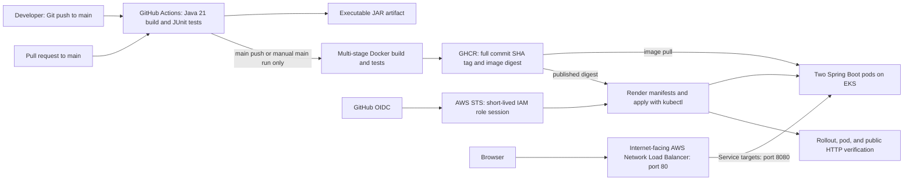

# Architecture and pipeline explanation

## Assignment scope

This project implements a Spring Boot dashboard and the configuration for an end-to-end cloud CI/CD pipeline. The original GKE target was changed to **Amazon EKS** at the user's request. GitHub hosts source and workflow execution; GHCR hosts images; AWS hosts Kubernetes and the public load balancer. Check that your university accepts the cloud-provider change before submitting.

## Application

`DashboardApplication` starts Spring Boot. `DeploymentMetadata` binds the `deployment.*` properties in `application.yml`; placeholders read `APP_NAME`, `APP_VERSION`, `APP_ENVIRONMENT`, `DEPLOYMENT_MESSAGE`, and `COMMIT_SHA`. `InfoController` returns the record as JSON. An empty commit SHA is omitted.

Spring serves `static/index.html` as the welcome page. JavaScript fetches metadata and health independently every 30 seconds. It uses `textContent` to display metadata as text. The dashboard's stage diagram explains the delivery path, while GitHub Actions remains the source of actual workflow status.

Actuator exposes health only, without internal details. Liveness asks whether the process should be restarted. Readiness controls whether a pod should receive traffic. A startup probe gives slow startup time before liveness and readiness checks begin.

## CI and image publication

The workflow has three jobs with explicit dependencies:

1. **ci:** checkout, Temurin Java 21 setup, Maven `clean verify`, JUnit reports, and executable JAR artifact. This runs for PRs, main pushes, and manual dispatch.
2. **publish:** only after CI succeeds on a main push or a manual main run. The multi-stage Dockerfile rebuilds from the same checked-out source and reruns tests. GHCR login uses the job-scoped `GITHUB_TOKEN` with `packages: write`.
3. **deploy:** only after publication succeeds and `DEPLOY_ENABLED=true`. GitHub OIDC assumes an AWS role, kubectl is installed for the cluster's minor version, and the existing EKS cluster is targeted.

PR jobs have neither registry write permission nor AWS OIDC permission. There is no `pull_request_target` trigger. Manual dispatch on another branch can run CI but cannot publish or deploy.

The JAR artifact is useful evidence; the Docker builder independently packages its own JAR. They are not assumed to be byte-identical. Deployment uses the exact **published Docker image digest**, which is the deployment identity that matters here.

## Immutable deployment and rollback

Images are named `ghcr.io/moksha3110/cia2-devops-dashboard:<40-character-commit-sha>`. Deployment appends the returned `@sha256:<digest>` so it remains tied to the exact image even if someone overwrites a tag later. SHA tags themselves are a naming convention, not registry-enforced immutability. No deployment uses `latest`.

`scripts/deploy.sh` renders the image and commit into temporary manifests before applying anything. The placeholder image in the checked-in manifest is never deployed by the workflow. The image digest and application commit SHA are separate concepts: the digest identifies container content, while the SHA identifies the source commit.

The Deployment has two replicas, zero unavailable pods during rolling updates, and at most one extra pod. Resource capacity must allow the third pod during a rollout. A failed rollout fails the workflow and prints diagnostics. It does not automatically roll back; a human can inspect and use `kubectl rollout undo` as documented.

## AWS and Kubernetes permissions

The default Service uses **EKS Auto Mode's NLB integration**. Standard EKS needs an installed AWS Load Balancer Controller and the documented Service class change.

The workflow IAM role needs `eks:DescribeCluster` on the chosen cluster. AWS authentication alone does not grant Kubernetes write access. An EKS access entry maps the role to the `github-deployer` Kubernetes group. The administrator applies `k8s/rbac.yaml` once, granting namespaced deployment/service writes and limited diagnostic reads. The pipeline cannot create clusters, edit IAM, create namespaces, or read Kubernetes secrets through that Role.

The application runs as UID/GID 10001, drops Linux capabilities, has a read-only root filesystem and a writable `/tmp`, and does not mount a service-account token. The worker nodes are amd64 because this pipeline publishes a linux/amd64 image.

## Public verification and limitations

After rollout, the script checks two ready pods and the expected image. It waits for a load-balancer hostname or IP. Python then verifies HTML delivery, health `UP`, and the expected version, environment, and commit SHA over the public URL. AWS NLBs commonly expose a DNS hostname, so verification supports that rather than assuming an IP.

Ansible provides an optional independent read-only check. HTTP is intentional for the assignment's public, non-sensitive demo metadata; a production system would also need TLS, domain management, monitoring, and appropriate network controls.

Local application and Docker verification succeeded. Registry publication, EKS provisioning, IAM integration, Kubernetes rollout, NLB provisioning, and public-cloud HTTP verification remain untested until configured and approved. See [the deployment guide](deployment-guide.md) and [evidence checklist](evidence-checklist.md).
