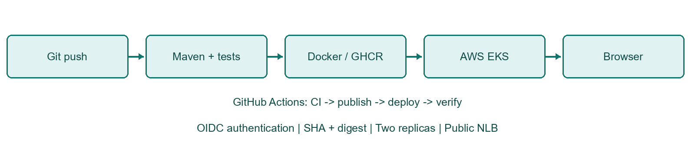
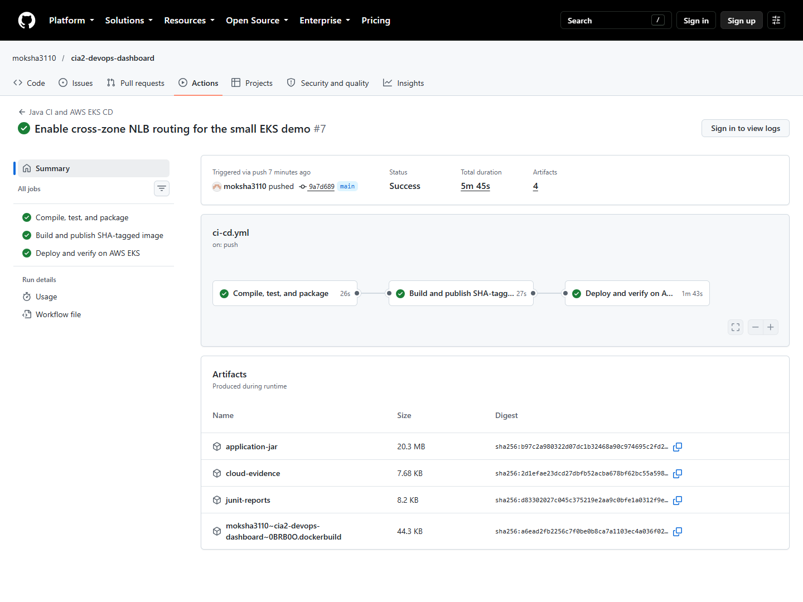
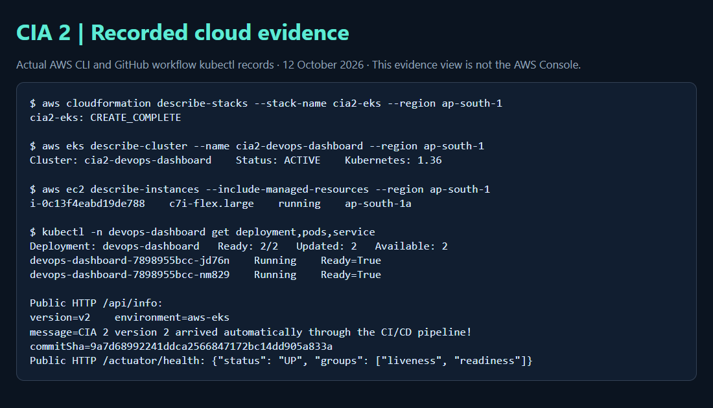
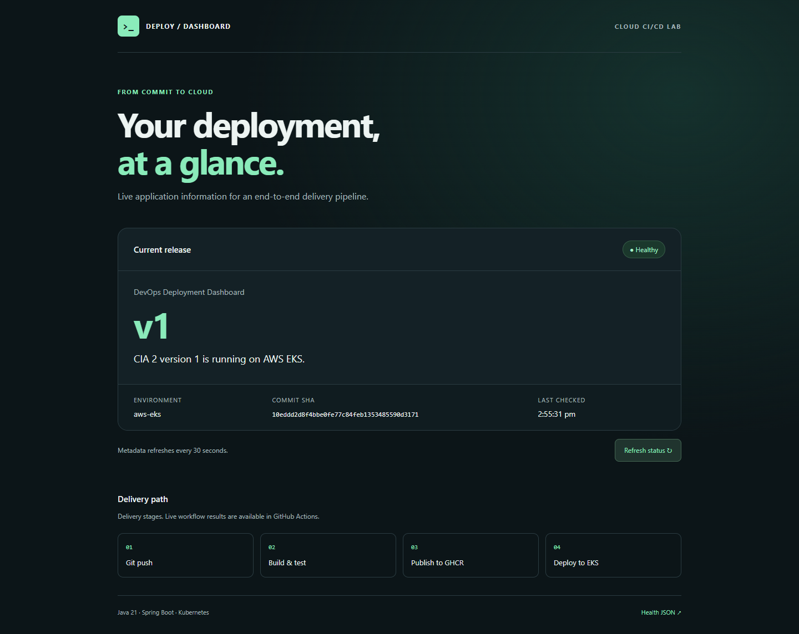
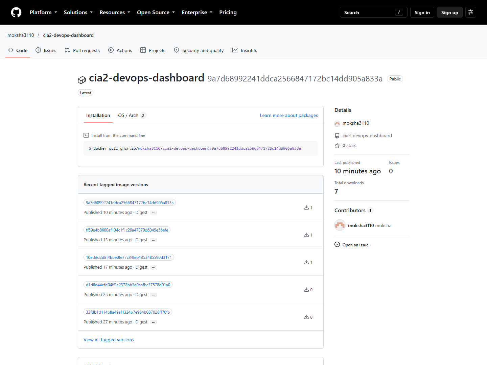
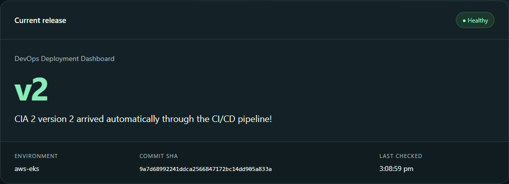

# Design and Implementation of an End-to-End Cloud-Based CI/CD Pipeline

| DEVOPS CIA 2 | STUDENT DETAILS |
| --- | --- |
| Name | Moksha |
| Roll number | 23011102074 |
| Class / section | IoT-B |
| Year | 4th Year |

Technical report | Evidence date: 12 October 2026 (IST)

## 1. Problem definition and architecture

Manual compilation, testing, image creation and deployment are slow, inconsistent and difficult to reproduce. This implementation automates those operations for a Java web application: a push to main triggers validation, publishes a container image and updates a cloud-hosted Kubernetes Deployment. A successful run must prove both rollout readiness and the public application identity.

The application is a lightweight DevOps Deployment Dashboard. It displays version, environment, deployment message and Git commit SHA, making the change from v1 to v2 visible. AWS was selected as the permitted cloud provider; Amazon EKS hosts Kubernetes, while GitHub Actions orchestrates delivery and GHCR stores images.

The deployment uses two replicas with rolling updates. The LoadBalancer Service maps public port 80 to application port 8080. Health probes control traffic readiness, and the verifier checks that the public endpoint reports the exact commit deployed by the workflow.

## 2. Tools selected and application implementation

| Tool | Purpose and justification |
| --- | --- |
| Java 21 / Spring Boot 3.5.16 | LTS Java runtime, concise REST APIs, embedded server and Actuator health probes. |
| Maven Wrapper 3.9.16 / JUnit 5 | Repeatable builds and automated endpoint/application tests. |
| Git / GitHub Actions | Version history and event-driven CI/CD with separate dependent jobs. |
| Docker / GHCR | Portable container packaging and SHA-tagged registry publication. |
| AWS EKS Auto Mode / Kubernetes | Managed Kubernetes with automatic compute and NLB integration. |
| Ansible | Optional read-only deployment verification using kubectl and HTTP checks. |

GET / serves responsive static HTML/CSS/JavaScript. GET /api/info returns name, version, environment, message and optional commitSha. GET /actuator/health returns overall health; liveness and readiness endpoints support Kubernetes probes. Metadata is supplied by APP_NAME, APP_VERSION, APP_ENVIRONMENT, DEPLOYMENT_MESSAGE and COMMIT_SHA, keeping the application independent of its deployment environment.

Eight automated tests cover context startup, property binding, optional SHA serialization, valid dashboard HTML, metadata JSON, health UP, liveness and readiness. MockMvc handles REST checks; an actual random-port HTTP request verifies the Spring welcome page. Tests set explicit metadata and require no database or external service.

The multi-stage Dockerfile builds and tests source with a JDK, then copies only the executable JAR into a smaller JRE image. Runtime UID/GID 10001 is non-root. Kubernetes drops all Linux capabilities, disables privilege escalation, mounts the root filesystem read-only and provides a bounded writable /tmp volume.

| Validation | Recorded result |
| --- | --- |
| Windows Maven clean test / package | 8 tests, 0 failures, 0 errors, 0 skipped; both commands passed. |
| GitHub CI test reports | 8 tests, 0 failures, 0 errors, 0 skipped (downloaded GitHub JUnit XML). |
| Configuration checks | actionlint passed; five Kubernetes resources passed schema validation; Bash and Ansible syntax checks passed. |

## 3. CI/CD pipeline stages

Pull requests to main run CI only. Pushes to main and manual dispatch run CI, publish, and (when DEPLOY_ENABLED=true) deployment. Job dependencies prevent a failing build from publishing an image or deploying. Repository variables hold identifiers; secrets and cloud access keys are absent from source.

| Stage | Implementation |
| --- | --- |
| Checkout / compile / test / package | Java 21 setup, Maven cache, ./mvnw clean verify; JUnit reports and executable JAR uploaded. |
| Build and publish | Buildx builds linux/amd64; GHCR login uses GITHUB_TOKEN with packages:write. Image tag is the full commit SHA. |
| Authenticate / connect | GitHub OIDC assumes a role allowed to describe only the target EKS cluster; kubectl matches its minor version. |
| Deploy / verify | Render image@sha256:digest and COMMIT_SHA; apply manifests; verify two ready updated replicas, pods and public HTTP metadata. |
| Evidence / Ansible | Save cluster/pod/service/HTTP evidence; manual runs also execute the Ansible verification playbook. |

Workflow source: .github/workflows/ci-cd.yml. The same published digest is deployed, so retagging an image cannot silently change the running artifact. The dashboard delivery path is explanatory; the GitHub run is the authoritative pipeline record.

## 4. Cloud resources and deployment approach

CloudFormation stack cia2-eks created a dedicated VPC, two public subnets in different Mumbai availability zones, an internet gateway, infrastructure IAM roles and an EKS Auto Mode cluster. Kubernetes version 1.36 was in standard support at creation. Public worker IPs provide egress to GHCR without a NAT gateway; security groups control inbound access.

The Deployment requests 100m CPU and 256Mi memory per replica, with limits of 500m CPU and 512Mi. RollingUpdate uses maxSurge=1 and maxUnavailable=0. A startup probe permits warm-up, readiness removes unhealthy pods from traffic and liveness detects failed processes. The Service requests an internet-facing Auto Mode network load balancer.

The namespace and RoleBinding were bootstrapped once. A temporary cluster-admin access policy was explicitly approved, used for bootstrap and removed afterward; its temporary workflow was also deleted. Routine CI/CD uses namespace-scoped RBAC rather than cluster-admin. The local root session could provision AWS resources but could not assume the Kubernetes administrator role.

Public application endpoint: http://k8s-devopsda-devopsda-fb98dd518c-5089fdf68ed45b95.elb.ap-south-1.amazonaws.com

## 5. Initial v1 deployment and registry evidence

Initial verified commit: 10eddd2d8f4bbe0fe77c84feb1353485590d3171

Manual verification run: https://github.com/moksha3110/cia2-devops-dashboard/actions/runs/38228883729

The registry package is public, so the cluster can pull it without storing a personal access token. The application verifier required HTTP 200, HTML content, health UP, aws-eks environment, expected version and the expected commit SHA. Optional Ansible verification result: 17 checks passed; changed=0, unreachable=0, failed=0.

## 6. Code change and automatic redeployment

After capturing v1, the application HTML subtitle was changed to describe automatic GitHub-to-AWS delivery. APP_VERSION changed from v1 to v2, and DEPLOYMENT_MESSAGE identified the automatic redeployment. These source/configuration changes were committed and pushed to main. No manual kubectl deployment command was used for the update; the push triggered CI, image publication and rollout.

| Traceability item | Recorded value |
| --- | --- |
| v1 commit | 10eddd2d8f4bbe0fe77c84feb1353485590d3171 |
| v2 source change | ff59e4b8600af134c1f1c20a47370d6045e56efe |
| v2 release commit | 9a7d68992241ddca2566847172bc14dd905a833a |
| Automatic v2 workflow | https://github.com/moksha3110/cia2-devops-dashboard/actions/runs/38230049122 |
| v2 outcome | Push-triggered run succeeded; 2/2 replicas ready; public health UP and commit SHA matched. |

The source-change push first succeeded in run 38229922992. The recorded final release also includes a follow-up Service annotation enabling cross-zone NLB routing; it was deployed automatically by the linked push run.

The recorded image reference includes both the full commit SHA tag and registry digest. Kubernetes evidence records two updated, ready, available replicas. Public HTTP verification compares COMMIT_SHA against the workflow commit, proving the visible version came from the expected source revision rather than a stale pod or cached page.

## 7. Challenges, security and limitations

| Challenge | Resolution |
| --- | --- |
| First Maven download failed on runner | The configured Maven URL was reachable; a retry passed. No test success was claimed for the failed attempt. |
| Root could not assume administrator role | Used explicitly approved one-time GitHub OIDC bootstrap; removed cluster-admin policy immediately afterward. |
| GHCR package visibility | Confirmed public package access before pulling from EKS; avoided a persistent registry password. |
| New GitHub OIDC subject format | Verified immutable owner/repository IDs through the GitHub API and restricted trust to the exact main-branch subject. |

Workflow permissions are scoped per job: CI reads source, publication writes packages, and deployment requests OIDC tokens. Untrusted pull requests do not publish or deploy. The AWS deployment role has only eks:DescribeCluster on the target cluster; Kubernetes Role/RoleBinding limits application operations to devops-dashboard. Containers run as non-root with restricted filesystem and capabilities.

Limitations: the demonstration uses public HTTP without TLS, a public Kubernetes API protected by authentication, and public worker subnets. Production should add HTTPS, a domain, stronger branch controls, private networking/runner access where appropriate, image vulnerability scanning, monitoring and alerting. Action versions and base image tags are versioned but not all pinned by digest. Successful rollout does not prove fault tolerance or load performance; no load test or failure-injection test was performed.

EKS, EC2, EBS, public IPv4 and the NLB incur charges while retained. This implementation does not claim free-tier eligibility. After assessment, delete the Service and wait for its load balancer to disappear, remove workloads/compute and then delete the dedicated CloudFormation stack; inspect for residual resources. Cleanup requires an intentional operation and has not been performed.

## 8. Submission evidence, live demonstration and references

Submission includes the public source repository, Maven Wrapper, application/tests, Dockerfile, .dockerignore, GitHub Actions workflow, Kubernetes manifests, optional Ansible playbook/inventory, CloudFormation template and detailed setup/troubleshooting guides. The reports/evidence directory contains original screenshots, recorded API/CLI evidence and test results used by this report.

Live demonstration sequence: open the dashboard and note the current version/SHA; open GitHub Actions; edit APP_VERSION and DEPLOYMENT_MESSAGE in k8s/deployment.yaml; commit and push main; watch CI, publish and deploy complete; refresh the public dashboard and compare its SHA with the commit. Explain the workflow guards, image digest, readiness probes, RBAC and rolling-update settings during the viva.

| Deliverable | Evidence location |
| --- | --- |
| Source and configuration | https://github.com/moksha3110/cia2-devops-dashboard |
| Pipeline execution | https://github.com/moksha3110/cia2-devops-dashboard/actions/runs/38230049122 |
| Working application | http://k8s-devopsda-devopsda-fb98dd518c-5089fdf68ed45b95.elb.ap-south-1.amazonaws.com |
| Tests / cloud state / screenshots | reports/evidence/ and GitHub run artifacts |
| Setup / troubleshooting / viva | docs/deployment-guide.md, troubleshooting.md, architecture.md, evidence-checklist.md |

Evidence integrity: dashboard, repository, pipeline and registry pictures are actual browser captures. Figure 2 explicitly presents saved AWS/kubectl output in an evidence view; it does not impersonate the AWS Console. No AI-generated image or invented deployment result is used. Raw workflow artifacts remain available subject to the configured retention period. Optional instructor-specific Console screenshots may be added separately.

## Primary references

AWS EKS Auto Mode CLI setup: https://docs.aws.amazon.com/eks/latest/userguide/automode-get-started-cli.html

AWS EKS access entries: https://docs.aws.amazon.com/eks/latest/userguide/access-entries.html

GitHub OIDC with AWS: https://docs.github.com/en/actions/how-tos/secure-your-work/security-harden-deployments/oidc-in-aws

GitHub Container Registry: https://docs.github.com/en/packages/working-with-a-github-packages-registry/working-with-the-container-registry

Docker multi-stage builds: https://docs.docker.com/build/building/multi-stage/

EKS pricing: https://aws.amazon.com/eks/pricing/
